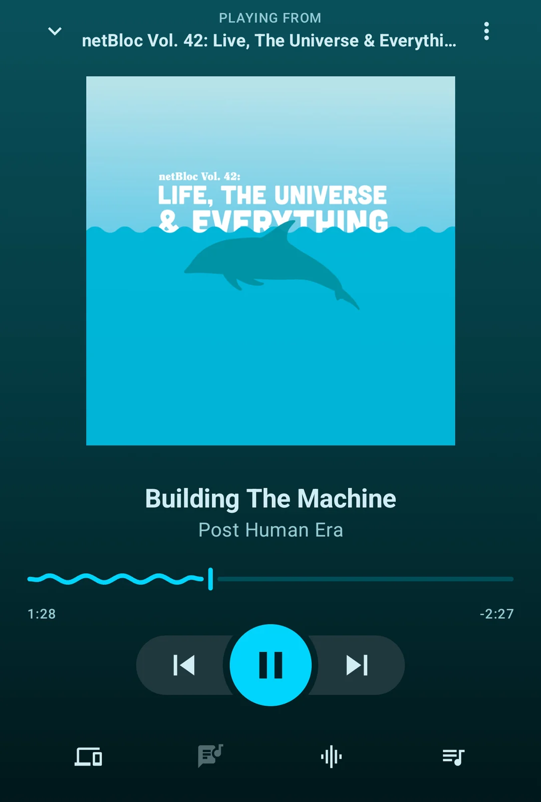
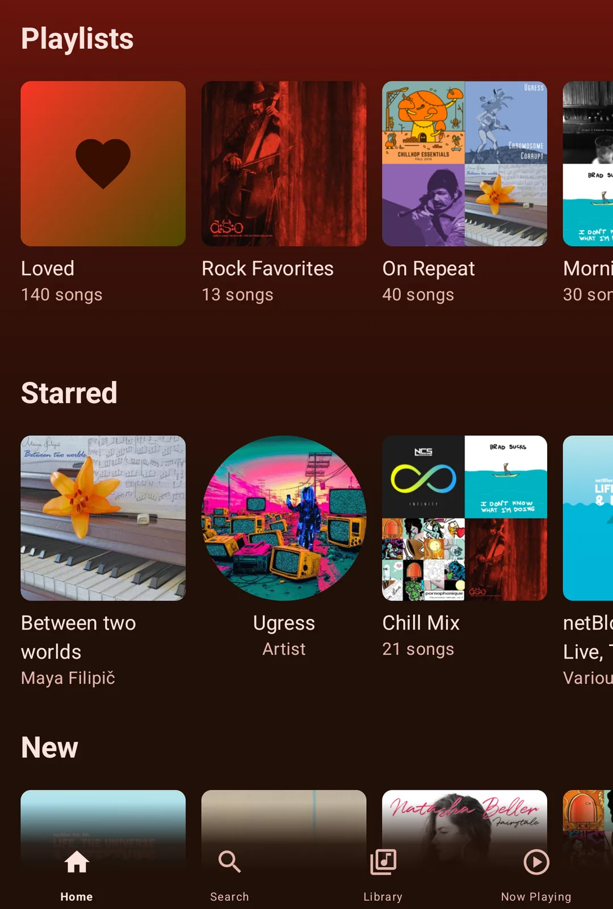
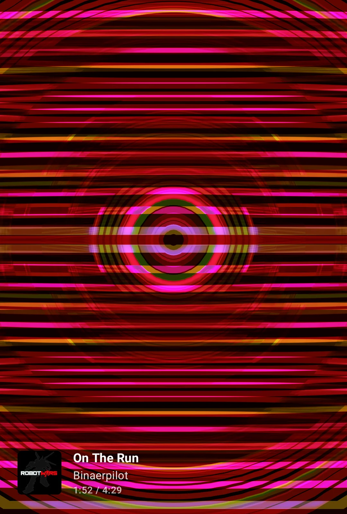
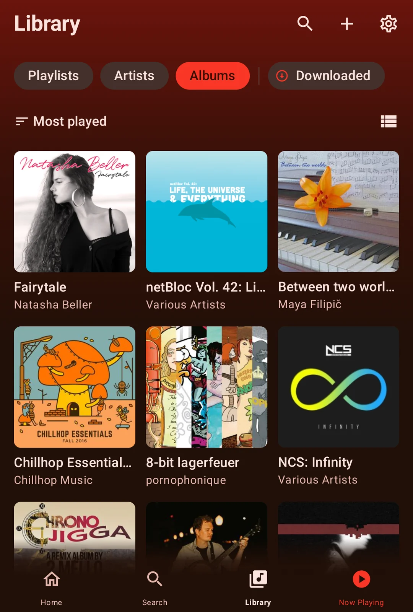
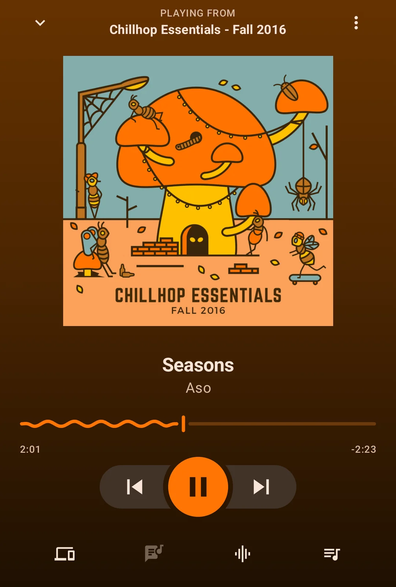
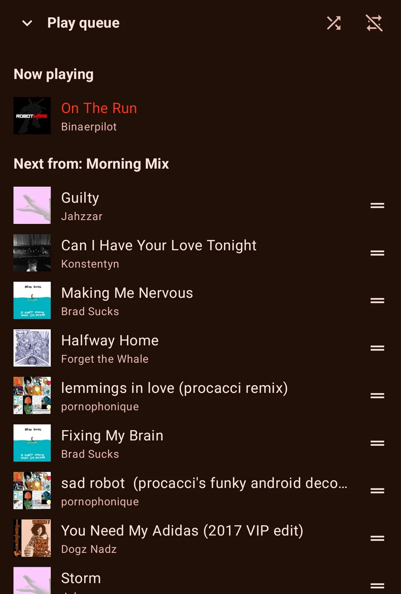

<p align="center"></p>

<p align="center"><a href="https://github.com/luke255/seidr/actions/workflows/check.yml"></a></p>

An Android music player for your [Navidrome](https://www.navidrome.org/) server.
Offline playlists that keep themselves up to date, a proper queue, and the
same app on your phone, foldable, car, TV and headset.

*Seiðr* (Old Norse, a kind of sorcery) is said "SAY-ther": like "safer", with
the *th* of "weather" in place of the *f*. ASCII spelling: Seidr.

<p>
  
  
  
</p>
<p>
  
  
  
</p>

<sub>Screenshots use Navidrome's public demo server and its Creative Commons music.</sub>

## Features

### Offline you can trust

- **Downloads stay in step with your server.** Switch on Download for a
  playlist or album and it looks after itself: songs added on the server
  download, and songs removed are cleared from your phone.
- **It won't lose your music.** A dropped connection or a server having a bad
  day never deletes anything.
- **Original quality.** Downloads are your files as they are on the server,
  and anything you've downloaded plays from the phone, even when you're
  online. To save mobile data, songs you haven't downloaded can stream at a
  lower bitrate that suits the connection.
- **Edit playlists anywhere.** Create, rename, add, remove, reorder and
  delete. Changes made offline are saved and sent when you're back.
- **Changes show up straight away**, even ones made on another device.

### Now Playing

- **Colours from the album art**, so every album looks like itself.
- **Lyrics that scroll smoothly with the song**, with a countdown through
  instrumental breaks. Tap a line to jump to it. If a song's lyrics are a
  little early or late, nudge them into time, and every device remembers.
- **Smoothly animated throughout**, from the progress bar to the artwork, and
  play, pause and skip fade gently instead of cutting.
- **Swipe the cover** to skip.
- **Even out volume** with your music's ReplayGain tags, and a
  **sleep timer** that fades the music away.

### A proper queue

- "Next in queue" plays before the rest of the playlist or album. Drag to
  reorder, swipe a song to add it.
- Shuffle you can undo: turn it off to get the original order back, or hold
  the button for a fresh shuffle.

### Everywhere

- **Android Auto**, with your recent music and playlists ready the moment you
  get in, and voice search.
- **Android TV**, with every screen built for the remote.
- **Foldables and tablets**, with two panes side by side.
- **Play on another device.** Pick a phone or TV on the same Wi-Fi and control
  it from this one.
- **Sign in from another device.** Already signed in on one device? Sign the
  next one in from Settings, checking a code on both screens. No typing
  passwords on a TV.
- **Play on a device that isn't signed in.** A friend's phone or a TV with
  Seiðr open shows up too, and plays your music with your login until you
  disconnect.

### MilkDrop visualiser

- Thousands of classic MilkDrop presets, reacting to your music in real time.
- Runs smoothly on everything from phones to TVs, adjusting itself to each
  device.
- Tap to play or pause, swipe to skip, and keep the presets you love.
- Swipe up or down through pages over it: controls, the track, lyrics, the
  queue, or the logo drifting through the preset.
- On a Meta Quest, step inside it.

### Kids' accounts

- **Music for the kids, filtered by you.** Give each child their own
  Navidrome account (not an admin), add it in Settings → Kids, then sign their
  phone or tablet in from yours with Settings → Sign in a device. It becomes a
  kid's device, and any device it signs in becomes one too.
- **You decide what they see and hear.** Adding a kid creates three public
  playlists on your account: `Seidr: Kids Approved`, `Seidr: Kids Safe Titles`
  and `Seidr: Kids Safe Art`. Songs in Approved play as normal. A song that's
  only in Safe Titles or Safe Art shows greyed out, with just its name or just
  its cover. Everything else stays out of sight.
- **Approve songs in Navidrome.** Seiðr keeps the three playlists out of
  everyone's library, so add and remove songs with Navidrome's web player or
  any other app. Kids' devices pick up changes straight away, and their
  downloads follow: approved songs can download, and songs you take back are
  removed.
- **It fails safe.** Only your copies of the playlists count, so a kid can't
  make their own. A missing playlist counts as empty, so until their device
  has fetched your lists, nothing plays.
- **Keep their password to yourself.** They sign in through you and never
  need it. With it, they could use Navidrome's web player or another app,
  which don't filter anything.

### Also

- **Colour themes:** Material You, a neutral dark look, or one of 16 colours.
- **Report problems** (optional): flag a song with a bad file, wrong art or
  broken lyrics, and it's added to a `Bad: Songs`, `Bad: Art` or `Bad: Lyrics`
  playlist on your server for whoever looks after it to fix.
- **What's new** in each version, in Settings → About.

## Install

Download the APK from the [latest release](https://github.com/luke255/seidr/releases/latest)
and open it on your device. You may need to allow installing apps from your
browser or file manager.

The APK is about 14 MB. The visualiser's presets (about 36 MB) download
separately, by themselves on Wi-Fi or when you first open the visualiser.

Seiðr updates itself: when a new release is out it offers to install it,
with what's new. You can turn the automatic check off in Settings → About.
If you'd rather use Obtainium, turn that check off so the two don't compete.

**Requirements:** Android 14 or later, and a Navidrome or gonic server. Seiðr
is built and tested on Navidrome. It also works with **gonic** (tested with
0.23: browsing, playback, offline downloads that follow the server, and
playlist editing), though changes there show up on the next sync rather than
straight away, and Save mobile data streams the original files, since gonic
doesn't convert for it. **LMS** doesn't work yet: it only accepts API keys,
and Seiðr signs in with a password. Other OpenSubsonic servers are untested.

**First run:** enter your server's address, username and password. On
Android 17, reaching a server on your home network needs the Nearby devices
permission, which Seiðr asks for. Android Auto only lists apps installed
outside the Play Store once "Unknown sources" is on in Android Auto's
developer settings.

## What it is, and isn't

Seiðr is opinionated. It's built around one Navidrome server, offline
playlists that mirror it, and a layout in the spirit of classic music apps,
and it tries to do those really well rather than everything. Ideas that fit
are welcome in [issues](https://github.com/luke255/seidr/issues).

**Not planned:**

- **Several servers at once.** One server, one login (kids' logins aside).
- **Jellyfin, Plex and other servers without the Subsonic API.** Jellyfin
  might happen one day, but it would mean a second version of everything that
  talks to the server, so not soon.
- **Music stored only on the phone.** Everything comes from your server.
- **Google Play.** Seiðr has no Google Play services and comes from GitHub
  Releases (or Obtainium).

## Problems?

[Open an issue](https://github.com/luke255/seidr/issues/new/choose). Settings →
About → Share a log gives you Seiðr's recent log to attach, with logins, server
addresses and device names taken out; you see the whole thing before it goes
anywhere. Questions are welcome in
[Discussions](https://github.com/luke255/seidr/discussions).

## Privacy

Seiðr has no analytics, tracking, ads or accounts of its own. It talks to:

- **your server**, for everything to do with your music;
- **GitHub**, to check for a new release (you can turn this off), and once
  to download the visualiser's presets from projectM's repositories;
- **other devices running Seiðr** on your local network, when you sign one in
  or play on one.

Your password stays on the device, encrypted at rest with a key held in
Android's Keystore. It isn't sent anywhere except your server, and to another
device you choose to sign in or play on, encrypted with a key agreed when you
checked the code on both screens. A device you play on keeps it in memory
only, until you disconnect.
Kids' logins you add are kept on your device the same way, only to sign their
devices in.

## How it's made

Seiðr is written entirely by Claude Opus (Anthropic's AI model), working in
Claude Code. It's designed, directed and tested by me, on real devices
(a Galaxy Fold, an Android TV, a Meta Quest 3 and Android Auto) and against a
real library. The rules that matter most, like never deleting
downloads on the strength of a bad response, are covered by unit tests.

The app's 25 translations are machine-translated too. They should read
naturally, but a native speaker will spot slips; corrections are very
welcome, as an issue or a pull request against `app/src/main/res/values-*/`.

## Building

You need JDK 17 or later and the Android SDK with NDK 30.0.16248370 and CMake
4.1.2. Then:

```sh
./gradlew :app:assembleDebug        # debug build (installs beside a release)
./gradlew :app:testDebugUnitTest    # unit tests
```

Lint has to pass too (`./gradlew :app:lintDebug`); `git config core.hooksPath
scripts/hooks` runs both before every push. Security reports: see
[SECURITY.md](SECURITY.md).

A release build is signed only if `~/.config/seidr/release.jks` and
`signing.properties` exist; otherwise it's unsigned and doesn't self-update.
`CLAUDE.md` describes the architecture and the rules the code keeps.

## Licence

Seiðr is free software under the [GNU GPL 3.0](LICENSE). It includes projectM
(GNU LGPL 2.1) and libraries under the Apache 2.0 licence; the app lists them
all in Settings → About → Open-source licences.

## Credits

Seiðr's MilkDrop visualiser stands on two decades of other people's work.
Thank you to all of them.

- **MilkDrop**: created by **Ryan Geiss** for Winamp (Nullsoft). Every preset
  here is written for it, and its ideas run through everything below.
- **[projectM](https://github.com/projectM-visualizer/projectm)**: the open-source,
  MilkDrop-compatible engine that renders it, by the projectM team and
  contributors. It ships unmodified as its own shared library, from
  `app/src/main/cpp/projectm` (version 4.1.8), under the
  [GNU LGPL 2.1](app/src/main/cpp/projectm/LICENSE.txt). That folder holds its full
  source, so you can rebuild it, or swap in your own build.
- **Presets**: the ["Cream of the Crop"
  pack](https://github.com/projectM-visualizer/presets-cream-of-the-crop),
  ~9,800 MilkDrop presets curated and sorted by **Jason Fletcher
  (ISOSCELES)**, as published by projectM. Seiðr doesn't ship them: the first
  time you open the visualiser (or sooner, on Wi-Fi), it downloads the pack
  from projectM's own repository, about 36 MB, and checks every file. Each
  preset is the work of its author, named in its file name, from Geiss himself
  to the hundreds of artists of the MilkDrop scene (Rovastar, Krash, Flexi,
  Martin, shifter, Eo.S., Aderrasi, suksma, Isosceles and so many more). Few
  presets were ever released under a licence. Like projectM, we treat them as
  freely shared, and **any author who would rather their work wasn't included
  can ask, and Seiðr will stop using it**.
- **Textures**: the
  [MilkDrop texture pack](https://github.com/projectM-visualizer/presets-milkdrop-texture-pack)
  collected by projectM: the textures that shipped with MilkDrop, plus others
  that popular presets rely on, downloaded the same way. The same removal
  offer applies.
