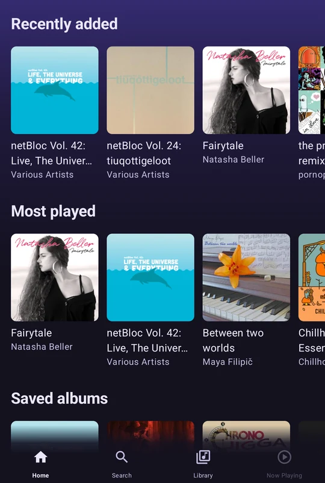
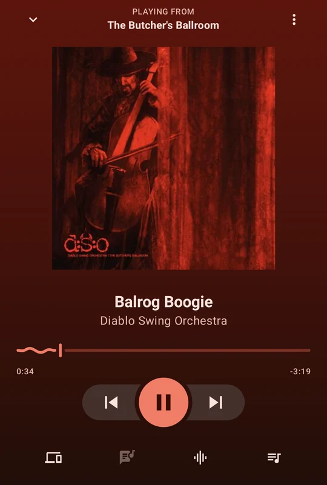
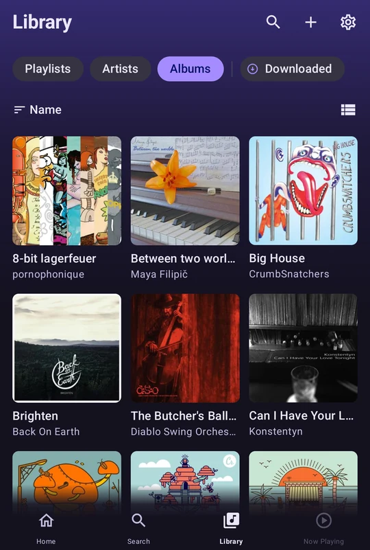
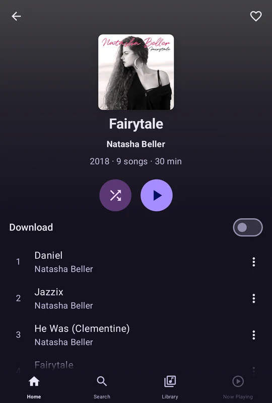
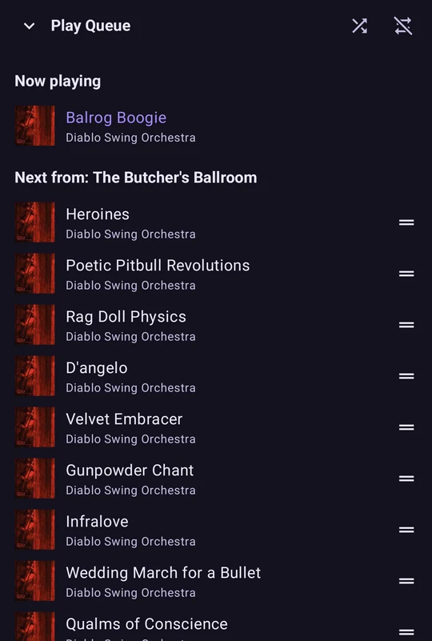
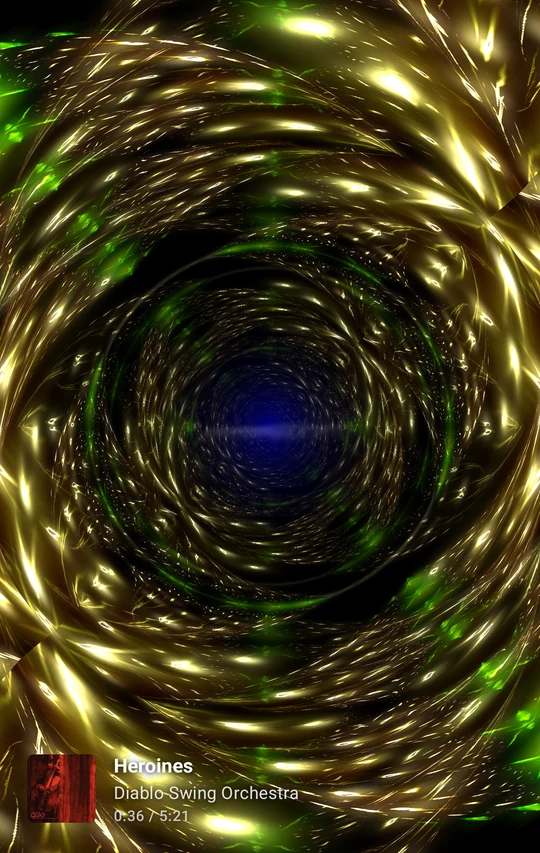

<p align="center"></p>

An Android music player for your [Navidrome](https://www.navidrome.org/) server.
Offline playlists that keep themselves up to date, a proper queue, and the
same app on your phone, foldable, car, TV and headset.

*Seiðr* (Old Norse, a kind of sorcery) is said "SAY-ther": like "safer", with
the *th* of "weather" in place of the *f*. ASCII spelling: Seidr.

<p>
  
  
  
</p>
<p>
  
  
  
</p>

<sub>Screenshots use Navidrome's public demo server and its Creative Commons music.</sub>

## Features

### Offline you can trust

- **Downloads stay in step with your server.** Switch on Download for a
  playlist or album and it looks after itself: songs added on the server
  download, and songs removed are cleared from your phone.
- **It won't lose your music.** A dropped connection or a server having a bad
  day never deletes anything.
- **Original quality.** Downloads are your files as they are on the server,
  and anything you've downloaded plays from the phone, even when you're
  online.
- **Edit playlists anywhere.** Create, rename, add, remove, reorder and
  delete. Changes made offline are saved and sent when you're back.
- **Changes show up straight away**, even ones made on another device.

### Now Playing

- **Colours from the album art**, so every album looks like itself.
- **Lyrics that scroll smoothly with the song**, with a countdown through
  instrumental breaks. Tap a line to jump to it. If a song's lyrics are a
  little early or late, nudge them into time, and every device remembers.
- **Smoothly animated throughout**, from the progress bar to the artwork, and
  play, pause and skip fade gently instead of cutting.
- **Swipe the cover** to skip.

### A proper queue

- "Next in queue" plays before the rest of the playlist or album. Drag to
  reorder, swipe a song to add it.
- Shuffle you can undo: turn it off to get the original order back, or hold
  the button for a fresh shuffle.

### Everywhere

- **Android Auto**, with your recent music and playlists ready the moment you
  get in, and voice search.
- **Android TV**, with every screen built for the remote.
- **Foldables and tablets**, with two panes side by side.
- **Play on another device.** Pick a phone or TV on the same Wi-Fi and control
  it from this one.
- **Sign in by QR code.** Already signed in on one device? Scan to sign in on
  the next. No typing passwords on a TV.

### MilkDrop visualiser

- Thousands of classic MilkDrop presets, reacting to your music in real time.
- Runs smoothly on everything from phones to TVs, adjusting itself to each
  device.
- Tap to play or pause, swipe to skip, and keep the presets you love.
- On a Meta Quest, step inside it.

### Also

- **Colour themes:** Material You, a neutral dark look, or one of 16 colours.
- **Report problems** (optional): flag a song with a bad file, wrong art or
  broken lyrics, and it's added to a `Bad: Songs`, `Bad: Art` or `Bad: Lyrics`
  playlist on your server for whoever looks after it to fix.

## Install

Download the APK from the [latest release](https://github.com/luke255/seidr/releases/latest)
and open it on your device. You may need to allow installing apps from your
browser or file manager.

Seiðr updates itself: when a new release is out it offers to install it.
You can turn the automatic check off in Settings → About.

**Requirements:** Android 14 or later, and a Navidrome server. Most features
work with any OpenSubsonic server, but live updates and cover art for
casting from a TV use Navidrome's own APIs.

**First run:** enter your server's address, username and password. On
Android 17, reaching a server on your home network needs the Nearby devices
permission, which Seiðr asks for. Android Auto only lists apps installed
outside the Play Store once "Unknown sources" is on in Android Auto's
developer settings.

## Privacy

Seiðr has no analytics, tracking, ads or accounts of its own. It talks to:

- **your server**, for everything to do with your music;
- **GitHub**, to check for a new release (you can turn this off);
- **your other devices**, on your local network, only when you sign one in by
  QR code or play on another device.

Your password stays on the device. It isn't sent anywhere except your server,
and to another device you choose to sign in, encrypted with a one-time key
from the QR code.

## How it's made

Seiðr is written entirely by Claude Opus (Anthropic's AI model), working in
Claude Code. It's designed, directed and tested by me, on real devices
(a Galaxy Fold, an Android TV, a Meta Quest 3 and Android Auto) and against a
real library. The rules that matter most, like never deleting
downloads on the strength of a bad response, are covered by unit tests.

## Building

You need JDK 17 or later and the Android SDK with NDK 30.0.16248370 and CMake
4.1.2. Then:

```sh
./gradlew :app:assembleDebug        # debug build (installs beside a release)
./gradlew :app:testDebugUnitTest    # unit tests
```

A release build is signed only if `~/.config/seidr/release.jks` and
`signing.properties` exist; otherwise it's unsigned and doesn't self-update.
`CLAUDE.md` describes the architecture and the rules the code keeps.

## Licence

Seiðr is free software under the [GNU GPL 3.0](LICENSE). It includes projectM
(GNU LGPL 2.1) and libraries under the Apache 2.0 licence; the app lists them
all in Settings → About → Open-source licences.

## Credits

Seiðr's MilkDrop visualiser stands on two decades of other people's work.
Thank you to all of them.

- **MilkDrop**: created by **Ryan Geiss** for Winamp (Nullsoft). Every preset
  here is written for it, and its ideas run through everything below.
- **[projectM](https://github.com/projectM-visualizer/projectm)**: the open-source,
  MilkDrop-compatible engine that renders it, by the projectM team and
  contributors. It ships unmodified as its own shared library, from
  `app/src/main/cpp/projectm` (version 4.1.8), under the
  [GNU LGPL 2.1](app/src/main/cpp/projectm/LICENSE.txt). That folder holds its full
  source, so you can rebuild it, or swap in your own build.
- **Presets**: the
  ["Cream of the Crop" pack](https://github.com/projectM-visualizer/presets-cream-of-the-crop),
  ~9,800 MilkDrop presets curated and sorted by **Jason Fletcher (ISOSCELES)**,
  as published by projectM. Each preset is the work of its author, named in its
  file name, from Geiss himself to the hundreds of artists of the MilkDrop
  scene (Rovastar, Krash, Flexi, Martin, shifter, Eo.S., Aderrasi, suksma,
  Isosceles and so many more). Few presets were ever released under a licence.
  Like projectM, we treat them as freely shared, and **any author who would
  rather their work wasn't included can ask, and it will be removed**.
- **Textures**: the
  [MilkDrop texture pack](https://github.com/projectM-visualizer/presets-milkdrop-texture-pack)
  collected by projectM: the textures that shipped with MilkDrop, plus others
  that popular presets rely on. The same removal offer applies.
